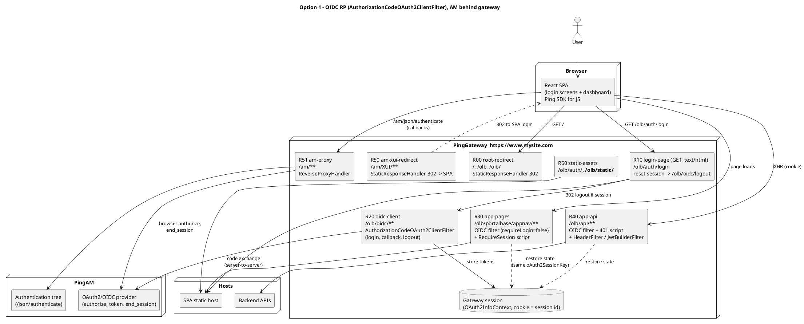
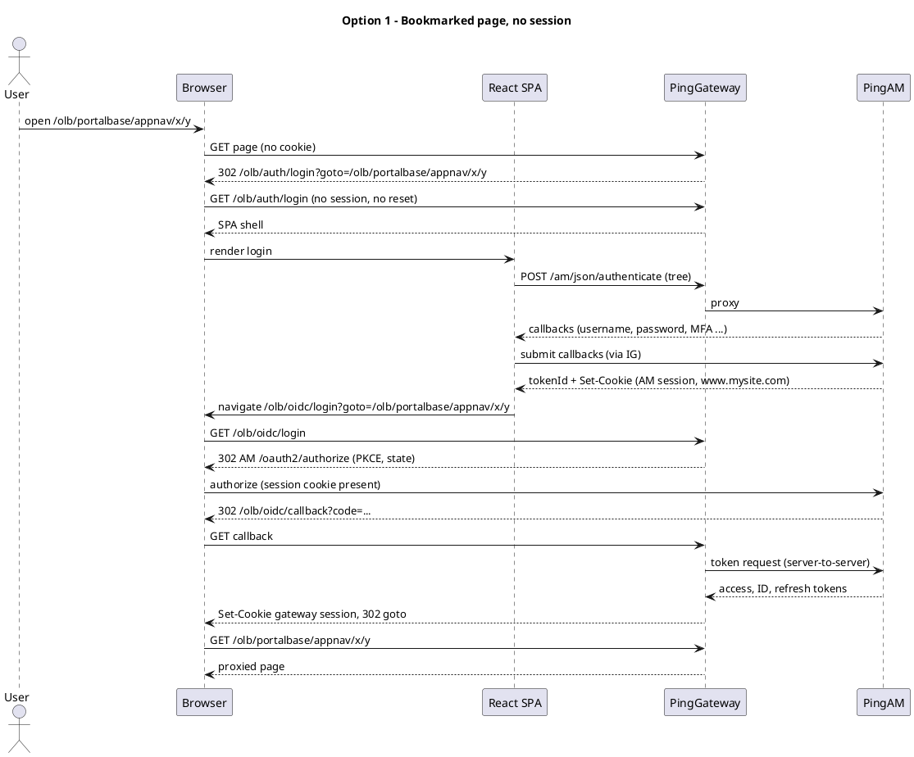
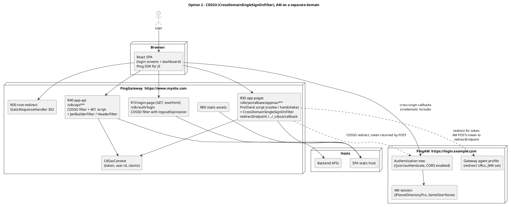
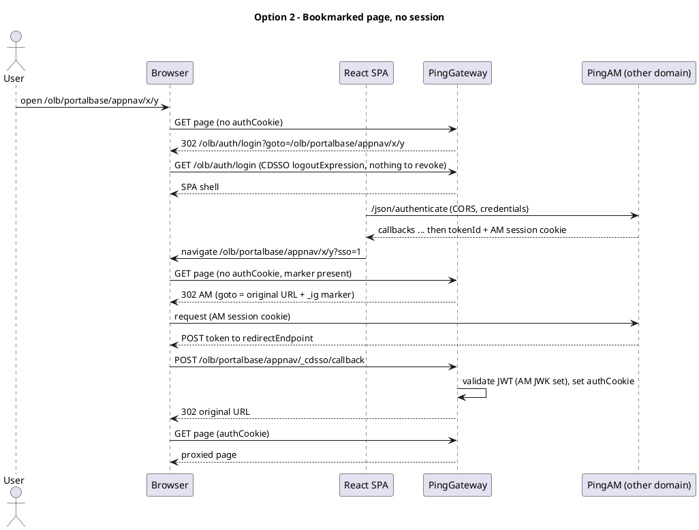

# OLB Web App on PingGateway + PingAM: Design Options

*Engineering design document. Based on the PingGateway 2026 reference pages for `AuthorizationCodeOAuth2ClientFilter` and `CrossDomainSingleSignOnFilter`. Items I could not confirm from those two pages are listed in section 7.*

## 1. Purpose and scope

Migrate a brownfield React web application to PingGateway-native patterns with PingAM as the identity provider.

- Unauthenticated pages: `/olb/auth/login/**`.
- Authenticated pages: `/olb/portalbase/appnav/<dir>/<page>`, landing on `/olb/portalbase/appnav/dashboard`.
- Login screens are React (SPA) screens that talk to AM authentication trees through the callback API.
- When AM issues a session, the original gateway route and its filter take over. The SPA never handles OAuth tokens.

Two options are compared:

1. **Option 1**: PingGateway as OIDC relying party (`AuthorizationCodeOAuth2ClientFilter`), with AM fronted by the gateway.
2. **Option 2**: PingGateway as CDSSO agent (`CrossDomainSingleSignOnFilter`), with AM on a separate domain.

## 2. Corrections to earlier guidance

The reference pages changed several things I said earlier:

| Earlier statement | What the 2026 reference says |
| --- | --- |
| Filter type `OAuth2ClientFilter` | The type is `AuthorizationCodeOAuth2ClientFilter`. |
| `target: ${attributes.openid}` | There is no `target` property. Token data is injected into `OAuth2InfoContext`. |
| One shared `/openid` endpoint used by many routes | `clientEndpoint` must be unique to one filter and route, and must equal the route condition or be a sub-path of it. Routes share the login state with the same `oAuth2SessionKey` instead. |
| `prompt=login` might need a script | `prompt` is a documented filter property. It applies to every authorization request the filter makes (see section 7). |
| Logout via custom script | `clientEndpoint/logout?goto=` plus `openIdEndSessionOnLogout` and `revokeOauth2TokenOnLogout` are built in. |
| `goto` handling | `goto` must be relative or have the same scheme, host and port as the original URI, otherwise the request fails. |

## 3. Requirements

| ID | Requirement |
| --- | --- |
| R1 | `GET /`, `/olb`, `/olb/` redirect to `/olb/auth/login`. |
| R2 | A bookmarked protected page with no valid session goes to the login page, then returns to that page after login. |
| R3 | An HTML hit on `/olb/auth/login` destroys any gateway and AM session, so the user can log in again. Loading the page's own assets must not do this. |
| R4 | Browser XHR to `/olb/api/**` gets 401 when unauthenticated, never a 302. |
| R5 | Login UI is the React SPA. AM XUI redirects become 302s to SPA screens (`StaticResponseHandler`). |
| R6 | Custom attributes (what was an ID token custom claim) reach the UI and backends. |

## 4. Option 1: OIDC relying party with AM fronted by the gateway

### 4.1 Idea

The gateway is a confidential OIDC client of AM. The browser holds only the gateway session cookie. AM is exposed through the gateway under `https://www.mysite.com/am`, so the AM session cookie is first-party and the SPA can call `/am/json/authenticate` without CORS. Any time AM would send the user to its XUI, a gateway route returns a 302 to the SPA login screen instead.

### 4.2 Component diagram



### 4.3 Route table

Use mutually exclusive conditions, and keep numeric prefixes only for readability. In PingGateway, the more specific condition must be matched before a broader one, so name `R50` so it sorts before `R51`.

| Route | Condition | Behaviour |
| --- | --- | --- |
| R00 root-redirect | path is `/`, `/olb` or `/olb/` | `StaticResponseHandler` 302 to `/olb/auth/login` |
| R10 login-page | `GET`, path `^/olb/auth/login/?$`, `Accept` contains `text/html` | If a gateway session exists, 302 to `/olb/oidc/logout?goto=/olb/auth/login`. Otherwise proxy the SPA shell. |
| R20 oidc-client | `^/olb/oidc` | Owns `clientEndpoint: /olb/oidc`. Serves `/olb/oidc/login`, `/callback`, `/logout`. |
| R30 app-pages | `^/olb/portalbase/appnav/` | OIDC filter (`requireLogin: false`) with its own sub-path endpoint, then script: no session means 302 to `/olb/auth/login?goto=<original path>`. Per-directory scope checks go in more specific routes. |
| R40 app-api | `^/olb/api/` | As R30, but returns 401 JSON instead of a redirect. Adds the downstream identity header or JWT. |
| R50 am-xui-redirect | `^/am/XUI/` | 302 to the SPA login screen, carrying the incoming query string (`goto`, `realm`, `service`). |
| R51 am-proxy | `^/am/` | Reverse proxy to AM. |
| R60 static-assets | `^/olb/auth/` and static prefixes (not matched by R10) | Reverse proxy to the SPA host. |

### 4.4 Key configuration

R20 (owns the callback):

```json
{
  "name": "OidcClient",
  "type": "AuthorizationCodeOAuth2ClientFilter",
  "config": {
    "clientEndpoint": "/olb/oidc",
    "registrations": ["am-olb"],
    "requireHttps": true,
    "requireLogin": false,
    "oAuth2SessionKey": "olb",
    "defaultLoginGoto": "/olb/portalbase/appnav/dashboard",
    "defaultLogoutGoto": "/olb/auth/login",
    "openIdEndSessionOnLogout": true,
    "revokeOauth2TokenOnLogout": true,
    "failureHandler": "OidcFailure"
  }
}
```

R30 and R40 each declare their own `AuthorizationCodeOAuth2ClientFilter` with the same `oAuth2SessionKey: "olb"`, `requireLogin: false`, and their own unique `clientEndpoint` (for example `/olb/portalbase/appnav/_oidc` and `/olb/api/_oidc`). Those endpoints never start a login. They only restore the stored authorization state, as the reference describes for "other request URIs".

R50 (AM XUI to SPA):

```json
{
  "name": "50-am-xui-redirect",
  "condition": "${find(request.uri.path, '^/am/XUI/')}",
  "handler": {
    "type": "StaticResponseHandler",
    "config": {
      "status": 302,
      "reason": "Found",
      "headers": { "Location": ["/olb/auth/login?${request.uri.query}"] }
    }
  }
}
```

AM settings:

- Confidential OAuth2 client `olb-web`, authorization code grant, scopes `openid` plus your custom scope.
- Redirect URI `https://www.mysite.com/olb/oidc/callback`. Post-logout redirect `https://www.mysite.com/olb/auth/login`.
- AM cookie domain set to `www.mysite.com`. AM base URL and context path match `/am` as seen by the browser.
- Realm goto URL validation must allow `https://www.mysite.com/*`.
- Custom claims: custom scope plus the OIDC claims script (and the access token script if backends validate the token).

### 4.5 Login sequence



If the AM session expires mid-use, AM would redirect to its XUI. R50 turns that into a 302 to the SPA login screen, and the SPA finishes by sending the browser back to the `goto` it received.

### 4.6 Requirement mapping

- **R3:** R10 sends logged-in users to `/olb/oidc/logout`, which clears the gateway session, calls the AM end session endpoint and revokes tokens. Also have the SPA login screen call AM session logout on load, so an AM session without a gateway session is cleared too.
- **R4:** the R40 script returns 401 for non-navigation requests.
- **R6:** claims in `OAuth2InfoContext`, then `JwtBuilderFilter` for backends and a `/olb/api/me` route for the UI.

### 4.7 Pros and cons

**Pros:** standards-based OIDC with PKCE and refresh, tokens stay server-side, built-in logout and revocation, backends can receive a real bearer token, AM treats the gateway as an ordinary OIDC client.

**Cons:** AM must be reachable through the gateway on the same host; the session-sharing arrangement across routes (same `oAuth2SessionKey`, separate endpoints) needs a proof of concept; the SPA must be aware of the final `/olb/oidc/login` hop.

## 5. Option 2: CDSSO with `CrossDomainSingleSignOnFilter`

### 5.1 Idea

Use this when AM is on a different domain from the gateway. AM cookies are not visible to the gateway, so the filter redirects the browser to AM, AM posts the session token back to the `redirectEndpoint`, and the gateway sets its own `authCookie` (default name `ig-token-cookie`) on its domain. The filter puts the CDSSO token, user ID and claims into `CdSsoContext`. There are no OAuth2 tokens in this option.

When AM is on the same domain, use `SingleSignOnFilter` instead.

### 5.2 Component diagram



*`The gateway never sees the AM login screens in this option, which is why section 5.4 needs the pre-check script`.*

### 5.3 Route table

| Route | Condition | Behaviour |
| --- | --- | --- |
| R00 root-redirect | `/`, `/olb`, `/olb/` | 302 to `/olb/auth/login` |
| R10 login-page | `GET`, `^/olb/auth/login/?$`, `Accept` contains `text/html` | `CrossDomainSingleSignOnFilter` with `logoutExpression` true for this route only. A valid AM session is revoked and the request continues to the SPA shell. With no session, the request also continues, with no validation. |
| R30 app-pages | `^/olb/portalbase/appnav/` | Pre-check script, then `CrossDomainSingleSignOnFilter` with its own unique `redirectEndpoint`. |
| R40 app-api | `^/olb/api/` | Pre-check returns 401 when the `authCookie` is missing, then the CDSSO filter. |
| R60 static-assets | `^/olb/auth/` and static prefixes | Reverse proxy to the SPA host. |

### 5.4 The XUI redirect problem

In Option 1 the AM XUI redirect can be intercepted because AM traffic goes through the gateway. In Option 2 the filter itself redirects the browser to AM on another domain, so the gateway never sees the XUI request. Use a pre-check script **before** the CDSSO filter:

1. No `authCookie` and no handshake marker: 302 to `/olb/auth/login?goto=<original path>` (SPA login).
2. The SPA completes the tree directly against AM (cross-origin, AM session cookie set on the AM domain).
3. The SPA navigates the browser to `<original path>?sso=1` (any marker name you choose; strip it before proxying).
4. Marker present and no `authCookie`: let the request reach `CrossDomainSingleSignOnFilter`. It redirects to AM, AM already has a session, so it returns immediately and posts the token to the `redirectEndpoint`. The gateway sets `authCookie` and returns to the original URL.

The filter's own `redirectionMarker` (default parameter `_ig`) prevents loops if the AM cookie is not sent. Keep it enabled.

### 5.5 Key configuration

```json
{
  "name": "CdssoFilter",
  "type": "CrossDomainSingleSignOnFilter",
  "config": {
    "amService": "AmService-olb",
    "redirectEndpoint": "/olb/portalbase/appnav/_cdsso/callback",
    "authenticationService": "olb-login-tree",
    "authCookie": {
      "name": "olb-sso",
      "path": "/olb",
      "httpOnly": true,
      "secure": true,
      "sameSite": "none"
    },
    "redirectionMarker": { "enabled": true, "name": "_ig" },
    "failureHandler": "CdssoFailure"
  }
}
```

- `sameSite: none` with `secure: true` is what the reference requires for CDSSO.
- Each route that carries the filter needs its own `redirectEndpoint`, and each must be registered in AM.
- Without `verificationSecretId`, the gateway validates the AM session JWT against the AM JWK set. Set it only if the JWK set cannot be discovered.
- `lifetime` (default 5 minutes) controls how long initial CDSSO state is kept.

### 5.6 Login sequence



### 5.7 Requirement mapping

- **R3:** `logoutExpression` on the login route revokes the AM session. Per the reference, define `defaultLogoutLandingPage`, or make the expression true only for this dedicated page. Never use a broad expression such as a query parameter that any caller could add.
- **R4:** the pre-check returns 401 when there is no `authCookie`.
- **R6:** claims come from `CdSsoContext` (session token claims). Put custom values in AM session properties in the tree, then forward them with `JwtBuilderFilter`.

### 5.8 Pros and cons

**Pros:** works when AM is on another domain, minimal AM client configuration, good fit if other AM-protected apps already share the AM session.

**Cons:** depends on third-party cookies (`SameSite=None`) for the SPA's cross-origin AM calls and for the CDSSO round trip, which browsers increasingly restrict; the SPA must drive the `?sso=1` handshake; no OAuth tokens, so backends only get what you mint at the gateway; logout and refresh logic is thinner than OIDC.

## 6. Comparison and recommendation

| Criterion | Option 1: OIDC RP | Option 2: CDSSO |
| --- | --- | --- |
| Browser credential | Gateway session cookie only | `authCookie` plus AM cookie on AM domain |
| Third-party cookie exposure | None (first-party everywhere) | High (`SameSite=None`) |
| AM network placement | Behind gateway at `/am` | Separate domain |
| AM XUI to SPA 302 | Native, route R50 | Not possible, needs pre-check handshake |
| Backend token | Real access token (plus JWT minted at gateway) | Gateway-minted JWT or headers |
| Logout | Built in (`end_session`, revocation) | `logoutExpression` on a dedicated route |
| Refresh | Built in (token refresh on `invalid_token`) | Session-based only |
| Fit to your requirements | Strong | Workable, more custom logic |

**Recommendation:** Option 1. Choose Option 2 only if AM cannot be placed behind the gateway host and an existing AM SSO estate requires CDSSO. If AM can share a registrable domain with the application, `SingleSignOnFilter` is simpler than either.

## 7. Open items to validate in a proof of concept

1. **Reading login state in a script.** The reference says tokens go into `OAuth2InfoContext`, but not the accessor name for Groovy or expressions. Confirm on the `OAuth2InfoContext` page.
2. **Shared session across routes.** Multiple filters with the same `oAuth2SessionKey` and distinct `clientEndpoint` values is my reading of the reference. Prove it before committing to it.
3. **`prompt`.** The filter property applies to every authorization request. Setting `prompt: login` may force a second credential prompt right after the SPA has just authenticated. The design above avoids it by ending the AM session on the login page instead. Test before enabling.
4. **Issuer endpoints.** When AM is reached through the gateway, decide which `Issuer` endpoints are the public URL (browser redirects) and which are internal (token exchange). See the `Issuer` and `ClientRegistration` pages.
5. **CDSSO AM-side setup.** The gateway agent profile, redirect URL registration and JWK set exposure are described in the CDSSO guide, which I did not read.
6. **Session store.** Stateful sessions need sticky sessions or a shared store, and stateless JWT sessions are limited by cookie size. Decide based on your HA model.
7. **`goto` validation.** Test AM realm goto URL validation and the gateway's same-origin `goto` rule with bookmarked URLs that include query strings.
8. **CSRF.** Cookie-authenticated mutating calls to `/olb/api/**` should require a custom header, in both options.

## 8. References

- CrossDomainSingleSignOnFilter: https://docs.pingidentity.com/pinggateway/2026/reference/CrossDomainSingleSignOnFilter.html
- AuthorizationCodeOAuth2ClientFilter: https://docs.pingidentity.com/pinggateway/2026/reference/AuthorizationCodeOAuth2ClientFilter.html
